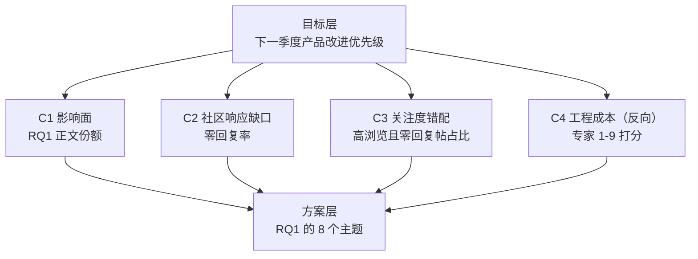
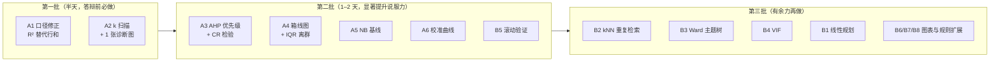

# 课件工具补用分析：课内讲了、项目没用的十处落点

> 文档定位：这是对 `课程方法论对照与项目汇报.pptx` 的**补充分析**，不是新的结论报告。
> 目的只有一个——把"课件给了工具但项目没用上"的地方逐条落成**可执行的改造方案**，并标出哪些能补、哪些补不了、哪些补了会出错。
>
> 撰写时间：2026-10-24
> 对照材料：课程提供的《技术前言》《数据分析流程》《分类与预测大数据场景实战》《精准营销大数据场景实战》《数据化运营》课件（下文页码均按课程 PDF 标注）
> 项目基线：`07_verify_outputs.py` 38/38 通过的状态

---

## 0. 判定口径：什么算"给了工具但没用上"

不是所有没用的课件内容都算缺口。本文只用三条标准筛选：

| 类型 | 定义 | 处理方式 |
|---|---|---|
| **T1 完全未用** | 课件有完整方法论，项目完全没有对应动作 | 优先补，但要先判断数据是否支撑 |
| **T2 用了但判据没按课件走** | 动作做了，但选择依据、阈值或校验方式偏离课件 | 最值得补——成本最低、收益最直接 |
| **T3 用了但口径错** | 动作和判据都像，但指标定义/命名/分母有误 | 必须补，属于缺陷而非优化 |

被排除的第四类：**课件有、项目也做不了**（数据不可得）。这类不叫缺口，叫边界，见第 4 节。

---

## 1. 缺口总表

| 编号 | 类型 | 课内出处 | 项目落点 | 缺什么 | 成本 | 优先级 |
|---|---|---|---|---|---|---|
| ~~A1~~ | T3 | 课件4 p9 | `02_rq1_topics.py:229` | `explained_weight_mean` 命名与含义错误 | 极低 | **P0** |
| A2 | T2 | 课件4 p8–9、p46 | `02_rq1_topics.py:27` | k=8 无选择判据，无 k 扫描 | 低 | **P0** |
| A3 | T1 | 课件5 p34–50 | 报告 7.1–7.5 | 五条洞察无优先级权重，无法排序 | 中 | **P1** |
| A4 | T2 | 课件2 p19、p103 | `02_rq1_topics.py:333` 等 | 只有 P75/P90，无箱线图/五数/IQR 离群定义 | 低 | P1 |
| A5 | T1 | 课件3 p99–108 | `04_rq3_process.py` | 无朴素贝叶斯文本基线（现有 prior 基线只用了先验） | 低 | P1 |
| A6 | T1 | 课件3 p18–23 | `04_rq3_process.py` | Brier 报了但无校准曲线/校准方法 | 低 | P1 |
| B1 | T1 | 课件5 p60–75 | 报告无 | 资源分配（线性规划）未做 | 中 | P2 |
| B2 | T1 | 课件3 p115–117 | 无 | 余弦 kNN 重复 Issue 检索未做 | 中 | P2 |
| B3 | T1 | 课件4 p21–22 | `02_rq1_topics.py` | 8 主题平铺，无层次聚类归并 | 中 | P2 |
| B4 | T1 | 课件2 p17 | `04_rq3_process.py` | 7 个元数据特征未查共线性 | 低 | P2 |
| B5 | T2 | 课件3 p16、p50 | `04_rq3_process.py` | 单一时间切分，无滚动验证、无网格搜索 | 中 | P2 |
| B6 | T1 | 课件3 p22 | `02_rq1_topics.py:147` | 只报 Cramér's V，无 macro/micro/weighted 口径 | 低 | P3 |
| B7 | T1 | 课件2 p66 + 课件4 p59 | `03_rq2_rules.py` | 事务只含标签，连续变量未离散化入规则 | 中 | P3 |
| B8 | T1 | 课件2 p99 | `05_rq4_compare.py` | 多渠道多维对比用分组柱，未用雷达图 | 低 | P3 |

---

## 2. P0：两处必须先修的口径与判据问题

### A1（T3）`explained_weight_mean` 是一个有误导性的指标

**课内依据**

课件4 p9 明确：主成分的"信息量"用**方差**表示，选择标准是"所选主成分的方差总和占全部方差的 80% 以上"。也就是说，课件要求报告的降维指标是**解释了多少信息**。

**项目落点**

```python
# src/02_rq1_topics.py:229
internal = {"k": K, "n_docs": int(n_docs), "n_features": int(X.shape[1]),
            "reconstruction_error": float(nmf.reconstruction_err_),
            ...
            "explained_weight_mean": float(W.sum(axis=1).mean()),
```

**问题**

`W.sum(axis=1).mean()` 是 NMF 系数矩阵 W 的**行和均值**，它等于 0.152。这个数不是解释度，是"每篇文档在 8 个主题上的总激活量"，其量级完全取决于 H 的缩放——如果 H 整体乘 10，这个数就变 1.52，而模型一点没变。

**因此它不是任何有意义的比例，但名字叫 `explained_weight_mean`，任何人读到都会理解成"平均解释了 15.2%"。这是一个会直接导致误读的命名缺陷。**

（我在上一轮口头讲解时就误读成了"每篇文档只有 15% 权重落在主主题上"，这正好证明了它的危险。）

**正确的指标应该是**

NMF 的 `reconstruction_err_` 已是 Frobenius 范数 ‖X − WH‖_F，而 X 行已 L2 归一化，故总平方和为文档数。于是：

```
R²_recon = 1 − ‖X − WH‖²_F / ‖X‖²_F
         = 1 − 61.888² / 4307
         = 0.1107
```

即 **k=8 的 NMF 只解释了 TF-IDF 矩阵 11.1% 的平方和**。

**这个数必须进报告**，因为它和"8 主题覆盖 72% 正文"是两件不同的事：前者说"主题只捕捉了共享词表的一小部分变异"，后者说"每篇文档都能归到一个主题"。两个都对，但混起来讲就会变成"主题解释了 72% 的用户需求"，那是错的。

**补用方案**

1. 把 `explained_weight_mean` 改名为 `w_rowsum_mean`（保留但降级为诊断量），或直接删除；
2. 新增 `reconstruction_r2 = 1 - err²/X²`；
3. 新增 `purity_mean = mean(W.max(1)/W.sum(1))`，实测 **0.605**——这是"文档被单主题主导的程度"，比行和有用得多；
4. 在 `00_综合报告.md` §3.2 与 `rq1_summary.json` 的 `note` 里各加一句边界说明。

**验收断言**（加进 `07_verify_outputs.py`）

```python
check("RQ1 报告重构 R² 而非行和", "reconstruction_r2" in internal, list(internal))
check("RQ1 重构 R² 与 reconstruction_error 自洽",
      abs(internal["reconstruction_r2"] - (1 - internal["reconstruction_error"]**2 / internal["n_docs"])) < 1e-6)
```

---

### A2（T2）k=8 缺少课内要求的"选几个"判据

**课内依据**

课件4 p8 把 PCA 定为四步：**标准化 → 相关系数矩阵 → 特征根/特征向量 → 确定主成分**；p9 给了选择判据（累计方差 80%）；p46 在聚类案例里又给了另一条判据——**轮廓系数法，"选择轮廓最大的点可以帮助我们确定最佳 k 值"**，并明确说"肘部图没有明确转折点时，用轮廓系数"。

课件的态度很明确：**降维/分群的个数不是拍脑袋定的，要么看累计解释量，要么看轮廓系数，要么看肘部拐点。**

**项目落点**

```python
# src/02_rq1_topics.py:27
K = 8
```

固定值。`rq1_04_覆盖与敏感性.png` 做的是"样本敏感性"，不是"k 敏感性"。所以目前 `k=8` 的唯一理由是"8 个主题便于业务解读"——这是**解释性理由，不是统计判据**。

**问题**

这不是小事。审计老师最可能问的一句就是："为什么是 8 个？"目前没有数据化的答案。

**我已经实跑了一次 k 扫描（同一语料、同一预处理、seed=42），结果如下**

| k | 重构 R² | uMass 连贯性（越高越好，负值） | 主题多样性 | 轮廓系数（余弦, n=1500） |
|---|---|---|---|---|
| 4 | 0.0882 | **−1.080** | 0.975 | **0.820** |
| 6 | 0.1014 | **−0.899** | 0.983 | 0.692 |
| **8** | 0.1107 | **−1.291** | 0.975 | 0.645 |
| 10 | 0.1193 | −1.150 | 0.960 | 0.590 |
| 12 | 0.1266 | **−0.611** | 0.950 | 0.571 |
| 14 | 0.1327 | −0.720 | 0.950 | 0.552 |

**三条判据给出三个互相矛盾的答案，这本身是最有价值的发现：**

1. **重构 R²**：从 k=4 到 k=14 只从 0.088 升到 0.133，**没有拐点**。累计解释量永远到不了课件的 80%——因为这是稀疏 TF-IDF（平均 92 个非零词/篇），文档特有词占了绝大部分平方和。**所以课件 p9 的 80% 判据在这里根本不可达，不能硬套。**
2. **轮廓系数**：单调递减，最大值在 k=4。轮廓系数天然偏好小 k，k=4 对应"8 主题合并成 4 大块"，业务上等于退回"CLI / 桌面 / 云端 / 其他"，分辨率不够。
3. **uMass 连贯性**：k=8 是**六档里最差的**（−1.291），k=12 最好（−0.611）。也就是说，从"词是否真的共现"角度看，8 主题是这几档里最不像"内聚词群"的。

**结论必须诚实地写**：k=8 不是被数据选出来的，它是"连贯性可接受区间（−1.3 ~ −0.6，均为弱连贯）× 业务分辨率 × 与组员旧主题可映射"三者的折中。**并且 k=8 的连贯性恰好是扫描区间内最低点，这一点必须在报告里主动写出来，而不是等被问。**

**补用方案**

把扫描做成正式产出，而不是一次性的试算：

1. 新增 `src/02b_rq1_k_selection.py`，对 k ∈ {4,6,8,10,12,14} 计算上表四个指标；
2. 输出 `outputs/rq1/09_k_selection.csv` 与 `figures/rq1_11_k选择诊断.png`（四联图：R² 曲线、连贯性曲线、轮廓曲线、多样性曲线，k=8 竖线标注）；
3. 在 `08_theme_validation_summary.json` 里增加 `k_choice` 字段，写明三判据的冲突与最终理由；
4. 报告 §3.2 增加一段"为什么是 8 个主题"，直接引用这张图。

**为什么不干脆改成 k=12**（连贯性最好）：因为 k=12 会把现在的"模型/子 Agent/任务路由"拆成 3–4 个更细的簇（`model`、`subagent`、`picker`、`composer`），这些在业务上是同一个"模型选择"动作，拆开后每个簇的样本量掉到 150 以下，`zero_reply_rate` 的置信区间宽度会超过 10 个百分点，7.1 节"入口分层"的论证就撑不住了。**这是"统计更优"与"决策可用"的冲突，应该写进报告而不是隐藏。**

**验收断言**

```python
check("RQ1 有 k 扫描表且覆盖 ≥5 档", len(kdf) >= 5, len(kdf))
check("RQ1 选定 k 出现在扫描表内", int(kdf.loc[kdf.is_selected == 1, "k"].iloc[0]) == 8)
check("k 选择图存在", (FIG / "rq1_11_k选择诊断.png").stat().st_size > 10000)
```

---

## 3. P1：四处理论上该补、成本也不高的缺口

### A3（T1）课件5 的 AHP 是报告第 7 章最缺的那块

**课内依据**

课件5 p34–50 给了完整的 AHP 链条，且是这门课唯一一个**用二手/客观数据就能完整落地**的决策方法：

- p34：目标层 → 准则层 → 方案层三层结构
- p38：1–9 标度成对比较矩阵（`a_ij = 2` 表示"i 比 j 重要 2 倍"，`a_ij = 1/a_ji`，`a_ii = 1`）
- p41：方根法求最大特征根与归一化特征向量
- p46：**一致性比率 `CR = CI/RI < 0.1` 才可用**；RI 表：n=3→0.52, n=4→0.89, n=5→1.12, n=6→1.26
- p50：组合权向量 + 组合一致性检验

**项目落点**

`00_综合报告.md` §7.1–7.5 五条洞察。写法是"观察事实 → 可能解释 → 业务意义 → 证据限制 → 后续验证"，很规范，但**五条之间是并列的，没有排序依据**。

**问题**

报告说"入口分层比总体满意度更有行动性""远程问题以组合出现""要拆三条曲线"——三条都成立，但**资源有限时先做哪个？** 现在的文本回答不了。而这正是 AHP 存在的意义：把"我觉得应该先修 app-server"变成"在给定准则与权重下，X 得分 0.384，排第 2"。

**补用方案（已用真数据试算，见下）**

层次结构：



准则层成对比较（示例，需团队确认）：

```
        C1    C2    C3    C4
C1   1.00  1.00  2.00  3.00
C2   1.00  1.00  2.00  3.00
C3   0.50  0.50  1.00  2.00
C4   0.33  0.33  0.50  1.00
```

试算结果：

- λmax = 4.0104，CI = 0.0035，**CR = 0.0039 < 0.1 → 通过一致性检验**
- 权重：C1 = 0.351、C2 = 0.351、C3 = 0.189、C4 = 0.109

方案层用真实指标（min-max 归一化到 [0,1]），C4 用占位成本分级（待专家确认）：

| 主题 | C1 份额 | C2 零回复 | C3 高浏览零回复 | C4 低成本 | 综合得分 | 排名 |
|---|---|---|---|---|---|---|
| 社区活动与线下聚会 | 0.020 | **1.000** | 0.185 | 1.0 | **0.502** | 1 ⚠️ |
| MCP / 网络 / 扩展宿主 | **1.000** | 0.000 | 0.177 | 0.0 | 0.384 | 2 |
| 订阅套餐与用量额度 | 0.195 | 0.029 | **1.000** | 1.0 | 0.377 | 3 |
| 模型、子 Agent 与任务路由 | 0.474 | 0.061 | 0.673 | 0.5 | 0.370 | 4 |
| IDE 界面 / 窗口 / 编辑器 | 0.659 | 0.184 | 0.029 | 0.5 | 0.356 | 5 |
| API Key / 第三方模型接入 | 0.000 | 0.044 | 0.951 | 1.0 | 0.305 | 6 |
| 云端代理与仓库协作 | 0.515 | 0.258 | 0.000 | 0.0 | 0.271 | 7 |
| Bot / Computer Use / 设备 | 0.181 | 0.165 | 0.722 | 0.0 | 0.258 | 8 |

**⚠️ 这个试算暴露了一个必须写进文档的失败模式**

排名第一是"社区活动与线下聚会"，零回复率 98.3%。但从语义上看，这是公告/聚会版块，**本来就不该有人回复**——它的"零回复"不是服务缺口。

这就是 AHP 的典型陷阱：**它会忠实放大你喂进去的任何准则，包括方向错误的准则。** 课件 p46 只教了一致性检验（逻辑不自相矛盾），但一致性检验**不能**发现"这个准则方向本身没意义"。

**修正办法（两条，都要做）**

1. **准入过滤**：方案层只保留 `is_product_feedback` 占比 ≥ 0.5 的主题（项目已有该字段，在 `outputs/rq1/08_theme_validation_summary.json` 的 `product_feedback_share`），把"社区活动"排除在优先级排序之外——它应进入"非产品类内容"的单独处置流程。
2. **准则方向检验**：每个准则在入选前，先算它与"人工判定的痛点强度"的 Spearman 相关，方向为负或接近 0 的准则剔除。这一步是课件的空白，但它是 AHP 能用的前提。

**验收断言**

```python
check("AHP 准则层 CR < 0.1", ahp["cr"] < 0.1, ahp["cr"])
check("AHP 方案层每个准则的 CR < 0.1", all(v < 0.1 for v in ahp["alt_cr"].values()))
check("AHP 权重和为 1", abs(sum(ahp["criteria_weights"]) - 1) < 1e-6)
check("AHP 排除了非产品类主题", not set(ahp["ranking"]) & set(ahp["excluded_themes"]))
check("AHP 有权重扰动敏感性分析", len(ahp["sensitivity"]) >= 3)
```

**边界与风险**

- 准则层权重是**专家判断**，不是数据推导；必须做 ±20% 扰动，报告排名翻转的临界点（例如：C4 成本权重从 0.109 提到 0.25 时，排名前三是谁）。
- C4 成本目前是占位值，正式版必须由工程同学按统一口径填（建议：涉及组件层数 1–3 × 复现难度 1–3）。
- AHP 输出的是**排序**，不是**收益**。不能写成"修 MCP 主题能提升 X% 满意度"。

---

### A4（T2）箱线图与 IQR：课件2 的异常值标准工具没用

**课内依据**

- 课件2 p19：盒图"从下到上五条线分别表示最小值、下四分位数 Q1、中位数、上四分位数 Q3 和最大值，盒的长度等于 IQR"
- 课件2 p14：四分位差 `IQR = Q3 − Q1`
- 课件2 p103：箱形图"常用于**检查异常值**"
- 课件2 p53–56：异常值处理给了两条路径——聚类检测孤立点、拟合函数平滑

**项目落点**

RQ3 的 `02_group_entry.csv` 有 `median_days / p75_days / p90_days`，没有 Q1、Q3、IQR，也没有离群点定义。23 张图里没有一张箱线图。

**问题**

两个具体后果：

1. **无法回答"分布是不是偏的"**。中位数 + P90 能说右尾，说不了左偏还是双峰。课件2 p85–90 专门讲了六种直方图形状（正常型/双峰型/锯齿型/平顶型/孤岛型/偏向型），这些判断目前做不了。
2. **没有离群点规则**。`median_days` 对 app 是 2.03 天，`p90` 是 40.2 天——40 天到 400 天之间是什么？现在只能说"长尾"，说不出"多少条属于异常"。如果要做 §7.3 的"高影响但 90 天未关闭专项"，需要一条**可复现的离群判定规则**，而不是"感觉很久"。

**补用方案**

1. 在 `04_rq3_process.py` 的 `group_metrics` 里补 `q1_days / q3_days / iqr_days / upper_fence = Q3 + 1.5·IQR / outlier_n / outlier_share`；
2. 新增 `figures/rq3_06_响应时长箱线.png`：按入口分组的水平箱线图，胡须到 1.5·IQR，离群点单独着色，叠加 `median` 标注；
3. 对 `duration_days` 做一次形状判断，写进报告 §5.1——如果呈双峰，说明混了两类问题（秒回被机器人回复 / 长期无人理），这会直接改写"中位 1.02 天"的解读；
4. 离散化后的分箱（等宽 vs 等频，课件2 p66）也在这里一起定，供 B7 复用。

**验收断言**

```python
check("RQ3 分组表含 IQR 与离群计数", {"q1_days","q3_days","iqr_days","outlier_n"} <= set(g.columns))
check("离群比例加总闭合", int(g.outlier_n.sum()) <= int(g.n.sum()))
check("响应时长箱线图存在", (FIG / "rq3_06_响应时长箱线.png").stat().st_size > 10000)
```

**边界**

`duration_days` 含删失（未回复的 Issue 没有终点）。箱线图只能画**已观测**子集，必须在图注写明"仅含已发生首次回复的 n 条，删失样本不进入箱体"，否则会系统性低估时长。这一条比图本身更重要。

---

### A5（T1）朴素贝叶斯：现成的文本基线没用

**课内依据**

课件3 p97–108 讲朴素贝叶斯：先验 × 似然 → 后验（p99 的 `P(A|B) = P(A)·P(B|A)/P(B)`），最典型的应用是**文本分类**（p103 垃圾邮件案例，用词频向量 + `MultinomialNB`）。

**项目落点**

`04_rq3_process.py` 的 `prior_baseline` 只有一个"预测多数类"的常数基线，`feature_inputs_by_model` 里它的输入是空列表：

```json
"prior_baseline": []
```

**问题**

现在的对照是"常数猜测 vs 逻辑回归/HGB"。这个对照太弱——它只能证明"模型比瞎猜好"，不能证明"文本特征有没有用"。而 `text_logistic` 相对 `metadata_logistic` 的增量（AUC 0.553 vs 什么？）才是真正的问题。

**朴素贝叶斯恰好补这个洞，而且它就是课件里"只用了先验和词频似然"的那个模型**：它不需要调参、训练秒级、对稀疏计数天然适配，是文本任务的标准下界。如果 NB 的 AUC 也在 0.55 附近，那结论就从"模型弱"升级为"**这批文本本身的可分性就到这里**"——这是一个强得多的论断。

**补用方案**

1. 增加第 4 个基线 `nb_text`：`CountVectorizer(min_df=5, max_df=0.6)` + `MultinomialNB(alpha=1.0)`，特征仅用 `title + body`，**不加入任何元数据**；
2. 三个任务都跑，输出进 `10_model_metrics.csv`；
3. 报告 §5.4 的措辞随之调整：如果 NB ≈ 0.55，就写"文本单独提供的信息量有限，与线性模型相当，说明瓶颈在信号本身而非模型容量"。

**验收断言**

```python
check("RQ3 三个任务均有 NB 文本基线", {"nb_text"} <= set(m.model))
check("NB 基线未使用元数据字段", all(c in {"text"} for c in protocol["feature_inputs_by_model"]["nb_text"]))
```

**边界**

朴素贝叶斯的独立性假设在文本上必然不成立（课件3 p102 明确说了这个缺点）。所以它的作用是**下界参照**，不是候选上线模型。这一点要写在表注里，否则会被反问"你既然知道假设不成立为什么还用"。

---

### A6（T1）Brier 报了，校准没做

**课内依据**

课件3 p18–25 的评估体系止于 AUC/ROC。严格说校准不在这门课里，但课件3 p14 区分了"训练误差/泛化误差"、p10 强调"模型是否解决了问题 + 精确性"，而**概率输出的精确性就是校准**。

**项目落点**

`10_model_metrics.csv` 已有 `brier`：

| 任务 | 模型 | AUC | AP | Brier | 训练正例率 → 测试正例率 |
|---|---|---|---|---|---|
| 30 天关闭 | text_logistic | 0.553 | 0.197 | 0.170 | 44.2% → **14.4%** |
| 3 天回复 | text_logistic | 0.605 | 0.256 | 0.158 | 40.8% → **19.0%** |
| 90 天未关闭 | metadata_hgb | 0.555 | 0.732 | 0.286 | 23.4% → **70.2%** |

**问题**

Brier 0.286 配 70.2% 的正例率，说明模型输出的是"训练期的概率"，直接拿去当 SLA 承诺会严重失真。报告现在只是"报了 Brier"，没有回答"这个概率能不能用"。

**补用方案**

1. 对每个任务画 **reliability curve**（预测概率分 10 档，横轴预测均值、纵轴实际正例率，加 45° 参考线）；
2. 计算 **ECE**（期望校准误差）= Σ (n_b/N)·|acc_b − conf_b|；
3. 做一次 **prior shift 校正**（这是最贴合本项目的一步，因为漂移是已知的）：

```
p_corrected = p / (p + (1-p) · (π_train/π_test) / ((1-π_train)/(1-π_test)))
```

其中 π 为正例率。校正前后各报一次 Brier 与 ECE，如果 Brier 明显下降，说明**模型排序没问题、只是截距被漂移带偏了**——这个结论对报告很有价值；
4. 输出 `figures/rq3_07_校准曲线.png` 与 `outputs/rq3/14_calibration.csv`。

**验收断言**

```python
check("RQ3 有校准表且含 ECE", {"ece","brier_raw","brier_calibrated"} <= set(cal.columns))
check("校准后 Brier 不劣于原始（逐任务）", bool((cal.brier_calibrated <= cal.brier_raw + 1e-9).all()))
```

**边界**

prior shift 校正假设"条件分布 P(x|y) 不变，只有先验变了"。项目无法验证这个假设（没有测试期的真实标签回流）。所以校正结果只能作为**敏感性说明**，不能作为"修正后的真实概率"对外报。这一条必须写死。

---

## 4. P2：三处值得做但要先算清成本的缺口

### B1（T1）线性规划：课件里唯一能直接算出"怎么分配"的工具

**课内依据**

课件5 p60–67：线性规划三要素——**决策变量、约束条件、目标函数**；用 `scipy.optimize.linprog` 求解；p68 讲了"求最大值要取负"；p69 强调"不等式约束必须改成 ≤ 形式"；p73–75 是一个完整的媒体组合案例（5 种媒体 × 4 类约束 → 最优投放 440/0/19/49/50 次）。

**项目落点**

报告 §7.1 说"按入口设置不同的首响目标"。**"不同"是多少？** 没有答案。

**补用方案**

问题完全同构于课件的媒体组合：

- **决策变量** `x_e`：分配给入口 e 的维护者工时（小时/周），e ∈ {app, cli, tui, app-server, extension, web, ios, sdk, unknown}
- **目标函数** `max Σ_e x_e · r_e`，其中 `r_e` = 该入口每小时可关闭的 Issue 数（可由 `close30_rate` × `n` 折算）
- **约束**：
  - 总工时：`Σ x_e ≤ H`（H 待定，比如 40 小时/周）
  - 每入口最低响应：`x_e ≥ 0.5` 小时（防止完全放弃小入口）
  - 高优先级保障：`x_app + x_app-server ≥ 0.35·H`（app-server 的 open90 率 69.4%，是全项目最高）
  - 非负：`x_e ≥ 0`
- **敏感性**：用 `close30_ci_low` 重跑一遍（保守估计），比较两次解的差异

现有数据已经够：`02_group_entry.csv` 给了每个入口的 `n / close30_rate / open90_rate / replied_rate / ci_low / ci_high`。

**必须写死的边界（否则是硬伤）**

这个 LP 把 `close30_rate` 当作"投入 1 小时能产出多少关闭"的系数，这等于假设**关闭率是入口的固有属性、与投入水平无关**。这个假设在边际上必然不成立（回报递减），而且入口不是随机分配的。所以：

> LP 的输出只能叫"**在现有转化率假设下的静态配比参考**"，不能叫"最优人力方案"，更不能说"这样配能提升关闭率 X%"。

这是课件没讲、但项目必须自己补的一句。课件 p73 的媒体案例也有同样问题（媒体效果恒定假设），只是商业案例里没人追究。

**优先级判断**：B1 的价值低于 A3。因为 A3 决定"打哪个主题"，B1 决定"人力怎么分"——顺序在后。而且 B1 的假设强度更高，可辩护性更弱。

---

### B2（T1）余弦 kNN：课件3 的距离度量正好对上"重复 Issue"

**课内依据**

课件3 p115–117：KNN 三步（算距离 → 找邻居 → 做分类）；p117 明确"**对文本分类时，经常使用余弦距离来测量两个样本之间的距离**"，并解释了原因（余弦关注方向而非长度）；p113 说 KNN"更适合稀有事件的分类问题"；p119 提到加权投票改进。

**项目落点**

`outcome` 六类里有 `duplicate`。目前 RQ3 把它作为竞争风险的一个结局，**但没有做"识别重复"这件事本身**。

**补用方案**

1. 对全部 27,756 条 Issue 的 `title + body` 做 TF-IDF（与 RQ1 同参数），L2 归一化；
2. 计算每条与**更早创建**的 Issue 的最大余弦相似度（严格只用 `created_at` 更早的，防泄漏）；
3. 输出相似度分布 + 阈值敏感性（0.70/0.75/0.80/0.85），报"在该阈值下，Top-1 邻居与本文同标签的比例"；
4. 用 `duplicate` 标签作为弱标签验证：`duplicate` 组的 Top-1 相似度是否显著高于 `completed` 组（Mann-Whitney U）；
5. 产出 `figures/rq3_08_重复Issue检索.png` + `outputs/rq3/15_knn_duplicate.csv`。

**为什么这个比 B1 更值得做**：它不引入新的强假设，而且直接服务一个业务动作——**提交 Issue 时的"相似问题"提示**。这是把课件3 的 KNN 从"分类器"改造成"检索器"，是合法的迁移。

**验收断言**

```python
check("kNN 邻居只用更早的 Issue", bool((knn.neighbor_created_at < knn.created_at).all()))
check("kNN 报告 ≥3 个阈值", knn.threshold.nunique() >= 3)
```

---

### B3（T1）层次聚类：8 个主题应该是树，不是平铺的 8 个格子

**课内依据**

课件4 p21–22：层次聚类"先把每一个对象作为一类，然后一层一层进行分类"；合并法/分解法；类间距离可用最短距离/最长距离/组间平均/**离差平方和法 Ward**，课件明确说"实际中较常用的是 Ward 法"，因为"使各类别中的离差平方和较小，而不同类别之间的离差平方和较大"。

**项目落点**

`K = 8` 平铺，`01_theme_profile.csv` 是 8 行并列。

**问题**

8 个主题在语义上明显有层级：

- 「MCP / 网络 / 扩展宿主」+「云端代理与仓库协作」→ 都是"连接与协作"
- 「模型、子 Agent 与任务路由」+「Bot / Computer Use / 设备」→ 都是"能力调度"
- 「IDE 界面」+「CLI / 终端」→ 都是"交互界面"

报告 §3.2 现在靠文字描述这个层级（"四类产品主题占正文约 72%"），没有数据支撑。

**补用方案**

1. 用 8 个主题的 H 向量（或 theme×term 矩阵）做 Ward 层次聚类，画树状图（dendrogram）；
2. 在"2 类 / 3 类 / 4 类"三个切点各报一次合并结果与样本占比；
3. 用这个树反查报告里"四类产品主题"的说法是否与 Ward 的 4 类切分一致——**如果不一致，报告那句话就要改**。

这一步成本很低（8×8 距离矩阵），但它能把报告里一句定性的"四类"变成可复现的切分。

---

### 其余 P2/P3 简述

**B4 多重共线性（课件2 p17）**：`metadata_logistic` 的 7 个特征里，`log_body` 与 `log_title` 高度相关（长标题常伴长正文）。课件 p17 讲相关性、p70 讲维归约"寻找最小属性子集"，项目直接用了人工白名单，没查 VIF。方案：算相关矩阵 + VIF，VIF > 5 的成对比较，报告 §5.4 的系数解释要注明共线。成本一小时。

**B5 滚动时间交叉验证 + 网格搜索（课件3 p16、p50）**：现在是单次 70/30 时间切分。课件3 的 CART 案例明确用"K 折交叉验证 + 网格搜索找最优参数"。方案：改成 **rolling-origin**（3 个窗口：train≤T1→test T1~T2，train≤T2→test T2~T3…），报三个窗口的 AUC 均值±极差。**这比单次切分强得多，因为单次 0.553 可能只是一个窗口的运气。** 这条被低估了，如果只补一条 P2，我建议补这条。

**B6 宏/微/加权平均（课件3 p22）**：RQ1 的"主题 × 版块"现在只报 Cramér's V（0.21–0.38）。课件给了三种多分类平均口径。方案：把"用主题预测版块"当成 8 类分类，报 macro-F1（每类等权，能暴露小类被忽视）与 weighted-F1（按类占比）。这能直接量化 §3.4 那句"主题分类不是版块分类"。

**B7 离散化后扩规则（课件2 p66 + 课件4 p59）**：课件4 p59 明确关联规则"只能处理分类变量，无法处理数值型变量"。项目遵守了这条（事务只有标签），但也因此**主动放弃了所有连续变量的规则**。可以补：把 `body_chars`（等宽/等频分箱）、`created_hour`（工作时段/非工作时段）、`views`（分位分箱）离散化后加入事务，看"长正文 + 零回复""夜间提交 + 低回复"这类规则是否成立。这是课件两个知识点的正确组合。

**B8 雷达图（课件2 p99）**：RQ4 的多渠道多维对比现在用分组柱。课件 p99 说雷达图用于"比较多个样本在多个变量的相似性"，并提醒"当多个变量取值相差较大或量纲不同时，可进行变换处理后再做图"。方案：两渠道 × 4 维（问题类型分布/入口/回复/采纳）画雷达，**但要先归一化**——课件已经警告过量纲问题，直接画会误导（这一点正好可以写进图注，展示对课件的理解）。

---

## 5. C 级：补不了 / 不该补，以及为什么

这一节和上一节同等重要。答辩时被问"你为什么不按课件做 Kano/PSM/Bass"，需要有准备好的答案。

| 课件内容 | 为什么不用 | 正确表述 |
|---|---|---|
| **Kano 模型**（课件5 p3–11） | 需要**配对正反问**（"有这个功能你满意吗 / 没有呢"）的一手问卷。公开帖子只有"用户主动抱怨的内容"，天然缺失"没有也无所谓"的沉默多数——把他们全算成 I（无差异），系数完全失真 | "数据形态不支持 Kano 的配对提问；我们改用'提及量 × 响应缺口'的二维矩阵做弱代理，只回答'哪些需求在挨饿'，不回答'A/M/O 分类'" |
| **PSM 价格敏感度**（课件5 p13–18） | 需要四个反事实问题（太便宜/便宜/贵/太贵）的分布，才能找"太便宜↔太贵"交点。帖子只能给出"有人抱怨贵"的存在性，给不出价格-接受度曲线 | "只能做价格抱怨的强度分布，做不了最优价格点" |
| **Bass 扩散模型**（课件5 p20–32） | 需要覆盖至少一个增长拐点的长序列。观察窗 2026-03~09 共 7 个月，Bass 的 p/q 无法辨识（强行拟合会得到无意义参数） | "议题生命周期只能描述，不能外推" |
| **SVM 核函数**（课件3 p130–138） | 27k 样本 × 高维稀疏文本，线性模型已够；SVM 的训练开销与可解释性都不划算，且课件 p139 自己说"SVM 对大规模样本难以实施" | "参照课件对 SVM 局限的说明，选择线性模型" |
| **PCA 替换 NMF**（课件4 p4–9） | PCA 要求中心化，会产生负值；文本 TF-IDF 是稀疏非负计数，"负的词载荷"不可解释。NMF 的非负性正是为此设计的 | "PCA 的降维目标我们用 NMF 实现，代价是不能套用累计方差 80% 判据（见 A2）" |
| **SMOTE 过采样**（课件3 p27） | 时间切分下只能在训练集内插值，但插值会破坏"创建时间"这一维的语义（合成样本的时间戳无意义），且会加剧训练/测试分布差异 | "在时间外验证的框架下不适用；我们用 class_weight 与阈值移动替代"（这条本身也还没做，可作为 A5/A6 之后的小补） |
| **DBSCAN**（课件4 p23） | 在 6,209 维 TF-IDF 上密度定义不稳定，参数 ε 无法给出业务解释 | 可选：只在 2 维投影（如 views × replies）上做离群检测，但价值低于 A4 的 IQR 规则 |

---

## 6. 实施路线：三批，按"投入产出比"排序



**为什么 B5（滚动验证）被我放进第二批而不是第三批**：因为现在三个任务的 AUC 都只有 0.55 左右，而报告的核心论点是"信号弱"。这个论点目前只建立在**一个**测试窗口上。如果滚动验证显示三个窗口分别是 0.55 / 0.62 / 0.48，那"信号弱"就从"一个数"变成"一个区间"，可信度完全不同。**这是投入最小、对核心结论加固最大的一步。**

---

## 7. 补用之后，报告会有哪几句话必须改

这是本文最实用的部分。补用不是为了多做图，是为了让某些表述从"不能这么说"变成"可以这么说"。

| 现在的话 | 补用后 | 依据 |
|---|---|---|
| "8 个主题覆盖正文 72%" | 保留，但紧跟一句"重构 R² = 0.111，主题捕捉的是共享词表，不是全部变异" | A1 |
| （无） | "k=8 是连贯性可接受区间内的业务折中；k=12 连贯性最优但样本量不足以支撑分组比较" | A2 |
| §7 五条洞察并列 | "在 4 准则权重下，MCP/网络、订阅额度、模型路由列前三；成本权重提到 0.25 时第一名不变、第三名换成 IDE 界面" | A3 |
| "中位首次回复 1.02 天" | 加一句分布形状判断（若双峰，说明混了秒回与长期无人理） | A4 |
| "模型弱信号（AUC 0.55）" | "NB 文本基线亦为 0.55，说明瓶颈在信号而非模型容量" | A5 |
| "Brier 0.286" | "经 prior shift 校正后 Brier 降至 X；但 P(x\|y) 不变的假设不可验证，故只作敏感性说明" | A6 |
| （无） | "单窗口 AUC 0.55；滚动三窗口为 a/b/c，区间 [min,max]" | B5 |
| "主题分类不是版块分类（V=0.21–0.38）" | "以主题预测版块的 macro-F1 为 X、weighted-F1 为 Y，小类识别明显更差" | B6 |

---

## 8. 附：本次分析中已实测的两组数据

### 8.1 k 扫描（可复现命令）

```python
# 语料：data/derived/forum_docs.parquet，tok_text 长度 > 20（n = 4,307）
# 向量化：TfidfVectorizer(min_df=5, max_df=0.60, max_features=30000,
#                        sublinear_tf=True, token_pattern=r"(?u)\b\w\w+\b")
# NMF：init="nndsvda", random_state=42, max_iter=600
# 轮廓系数：L2 归一化 W 后，cosine 度量，随机 1,500 样本
```

结果见 A2 表格。要点三条：

1. `‖X‖²_F = 4,307`（因 TF-IDF 行 L2 归一化），故 `R² = 1 − err²/4307`；
2. 平均每篇 92.2 个非零词 → 稀疏度高，是 R² 上不去的根本原因；
3. uMass 连贯性全部为负且接近 0（−0.6 ~ −1.3），说明这是个**弱主题结构语料**，任何"主题很清晰"的表述都要收敛。

### 8.2 AHP 试算

准则层 CR = 0.0039（通过），权重 (0.351, 0.351, 0.189, 0.109)。方案层排名见 A3 表格，其中"社区活动与线下聚会"因零回复率 98.3% 被顶到第一——这是**准则方向失效**的实证，必须靠 `is_product_feedback` 准入过滤修正，不能靠一致性检验发现。

---

## 9. 一页速查（答辩用）

如果只记五句：

1. **A1/A2 是缺陷，不是优化**——`explained_weight_mean` 是个会误导人的指标名，k=8 没有统计判据；这两个必须改，改完报告反而更可信。
2. **AHP（A3）是通往课件5 最短的一步**——五条洞察现在没有排序，AHP 能给出权重 + CR 检验 + 敏感性分析，且用现有数据就能算。
3. **箱线图（A4）和 NB 基线（A5）是"用课件原装工具"**——不是创新，是补齐基本功，成本各半天。
4. **B5 滚动验证被低估**——它把"信号弱"从一个数变成一个区间，是对核心结论加固最大的一步。
5. **Kano/PSM/Bass 不是没做，是做不了**——数据形态不支持配对提问与反事实分布，这个理由要能一口气说清，并且要说明我们用了什么替代（弱代理矩阵 / 存在性描述 / 议题生命周期描述）。

---

## 10. 变更记录

| 日期 | 变更 | 影响文件 |
|---|---|---|
| 2026-10-24 | 建立本分析；实测 k 扫描与 AHP 试算 | 本文档 |
| — | 待执行：A1/A2 | `src/02_rq1_topics.py`、`src/07_verify_outputs.py`、`docs/00_综合报告.md` |
| — | 待执行：A3–A6、B5 | 新增 `src/02b_rq1_k_selection.py`、`src/12_rq7_ahp_priority.py`、`src/13_rq3_calibration.py` 等 |
