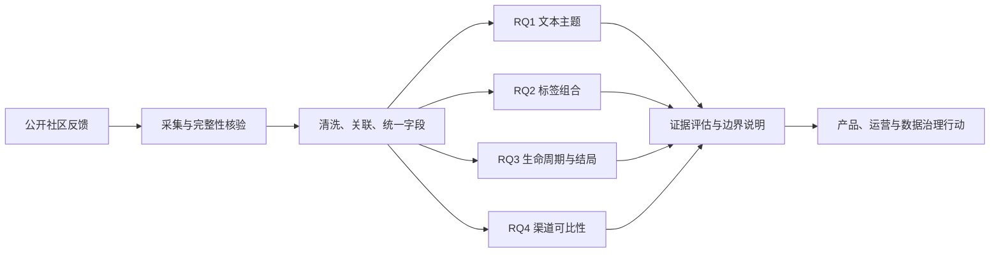

# AI 编程智能体的多源用户反馈与产品问题挖掘

## 从选题到业务结论的完整讲解

> 本文用于把项目的背景、数据获取、数据处理、算法分析、扩展任务、图表结果和业务含义串成一条完整叙事。项目的主对象是 AI 编程工具（AI coding agent），以 Cursor 官方论坛和 OpenAI Codex GitHub Issues/评论为主要反馈来源，Hacker News 仅作为辅助对照。所有比例必须结合各自分母和样本限制理解。

## 1. 为什么选择这个题目

AI 编程智能体已经从少数开发者尝试的工具，逐渐变成开发流程中的实际生产工具。用户使用它完成代码生成、调试、模型调用、仓库协作和自动化任务时，会留下大量公开反馈：论坛里的问题描述、GitHub Issue 中的缺陷和需求、评论里的追问与响应。这些内容比问卷更接近真实使用过程，但也更零散、更不结构化。

因此，本项目把问题定义为：能否从公开社区中的真实反馈，系统回答四个业务问题：

1. 用户主要在讨论哪些产品能力和使用问题？
2. 不同问题标签通常怎样组合，能否帮助分流和排查？
3. 一条反馈从提出到回复、关闭和完成，实际经历了什么过程？
4. 官方论坛和 GitHub Issues 反映的是不是同一类需求，两个渠道应该如何分别理解？

这四个问题形成一条递进链路：先识别需求内容，再识别问题组合，再观察反馈处理过程，最后将不同渠道放在同一个可比框架中解释。项目不把公开反馈直接当成全部用户意见，而是把它作为产品研究、反馈运营和问题治理的观察窗口。

## 2. 选品与数据源设计

选取 Cursor 和 Codex，核心不是产品名称相近，而是两者的反馈承载方式具有互补性：Cursor 是闭源商业产品，没有公开的 Issue 仓库，用户反馈主要集中在官方 Discourse 论坛；Codex 是开源项目，用户可以直接在 GitHub 仓库提交 Issue 并展开评论。这样可以观察两种不同的反馈漏斗：一个更接近产品用户社区，一个更接近技术问题管理流程。

项目保留的主数据包括：

| 数据源 | 规模 | 主要用途 |
|---|---:|---|
| Cursor 论坛主题元数据 | 41,218 个主题 | 版块、互动、时间结构 |
| Cursor 论坛正文 | 4,322 个主题、18,498 帖；清洗后 4,307 个主题 | RQ1 主题识别 |
| Codex Issues | 27,756 条 | RQ2 标签组合、RQ3 生命周期、RQ4 对照 |
| Codex 评论 | 115,280 条；97,034 条可关联 Issue | 外部回复和维护者回复 |
| Hacker News | 80,510 条原始记录；关键词过滤后作辅助样本 | 外部舆论对照，不承担核心结论 |

这些数字不能简单相加。论坛主题与正文帖存在包含关系，Issue 与评论是不同分析单位，因此每个研究问题都使用自己的明确分母。

### 2.1 数据是怎样采集的

采集脚本和过程记录保存在项目的采集模块中。论坛数据通过 Discourse 的 `site.json`、`latest.json` 和单主题 JSON 接口获取；GitHub 数据通过仓库 Issue、Issue 评论和 Search API 获取；Hacker News 通过 Algolia 接口按时间窗口抓取。实际采集时先探查总量和分页上限，再按时间切片，最后落盘。

下列链接可以直接打开本项目使用的数据源或对应接口：

- **Cursor 官方论坛**：[论坛主页](https://forum.cursor.com/)；[版块与站点信息](https://forum.cursor.com/site.json)；[公开主题流接口](https://forum.cursor.com/latest.json?order=created&ascending=false&page=0)；单个主题可按 `https://forum.cursor.com/t/{topic_id}.json` 打开，例如将 `{topic_id}` 替换为主题 ID。这些入口对应论坛主题元数据、主题正文和回复数据。
- **OpenAI Codex GitHub 仓库**：[仓库主页](https://github.com/openai/codex)；[Issues 页面](https://github.com/openai/codex/issues)；[Issue 搜索 API](https://api.github.com/search/issues?q=repo%3Aopenai%2Fcodex%20is%3Aissue)；[Issue 评论 API](https://api.github.com/repos/openai/codex/issues/comments?per_page=100)。这些入口对应 Issue 的标题、标签、状态、时间字段及评论数据。
- **Hacker News 辅助数据**：[Algolia 搜索页面](https://hn.algolia.com/)；[按时间搜索接口示例](https://hn.algolia.com/api/v1/search_by_date?query=cursor&tags=story&hitsPerPage=10)。HN 只作为外部对照，关键词检索存在撞词和语义噪声，因此经过相关性过滤后使用，不承担主结论。

这些链接是公开数据源入口，不等同于本项目最终保存的快照。项目分析使用的是按采集时间落盘、经过清洗并由 manifest 记录字节数、条数和 SHA-256 的本地数据版本。

数据完整性不是靠“脚本运行结束”来判断，而是通过独立方法交叉核验：论坛用版块计数总和与实抓主题数核对；Issues 用列表端点、Search API 和主键唯一性核对；评论用 Issue 内嵌评论与独立评论端点核对。六份主 JSON 的字节数、条数和 SHA-256 由 manifest 记录，项目运行时重新计算。

这一步对应课程中“先理解数据、再建模”的思想，也对应网络数据采集中的总量探查、分页处理、异常恢复和结果核验。HN 的模糊关键词会产生大量撞词，因此只保留相关过滤结果作为辅助镜头，不能把它当作主语料。

## 3. 数据清洗与统一底座

原始公开反馈没有统一字段，需要先建立可分析的数据底座。处理过程按照课程中的“清洗—集成—变换—规约”展开。

### 3.1 清洗

论坛正文逐帖去除 HTML 标签并清理代码块、诊断页脚和 Discourse 缺陷模板页脚，再按主题把已采集帖子串接成 `text_all`；同时保留首帖文本 `text_op` 供其他分析使用。主 RQ1 当前实际使用的是 `tok_text`（由 `text_all` 分词得到），不是只用首帖。清洗前正文覆盖 4,322 个主题，清理后 4,307 个主题进入主题建模。Issue 和评论统一时间格式、状态字段、标签字段和作者身份字段。

### 3.2 集成

六份 JSON 归一到统一字段结构，Issue 与评论通过 Issue 编号关联。评论中有 18,246 条无法关联到 Issue，因此它们不进入回复时间计算；这意味着无回复比例可能被高估，报告中必须明确这个限制。

### 3.3 变换

项目建立统一分类字典，按“入口—能力—环境—问题类型—处理结果”组织字段。RQ1 将清洗后的主题文本转成 TF-IDF 单词项矩阵；预测模型另按其任务配置文本特征。RQ2 把一条 Issue 的多标签转换为一笔事务；生命周期分析把创建时间、回复时间、关闭时间转换为持续时间和事件状态。

### 3.4 规约

RQ1 只保留有正文且长度合格的主题；RQ2 只保留有标签的 Issue，并以多标签 Issue 作为关联规则事务；RQ3 保留创建时可见的特征用于预测，避免把最终状态和评论信息泄漏进模型；RQ4 只用两个渠道都能取得的标题字段和同一套关键词规则。

处理后的数据被写入 `data/derived/`，分析表写入 `outputs/`，图片写入 `figures/`，原始数据保持只读。这样可以让后续每个数字都回溯到具体表和脚本。

整个项目可以概括为下面这条证据链：

这条链的关键不是“每一步都使用复杂算法”，而是让每个算法都回答一个前面已经定义清楚的问题，并且让结果回到可执行的业务判断。

## 4. RQ1：用户在讨论什么

### 4.1 研究问题与方法

论坛没有一套可以直接代表正文内容的业务分类，版块只是用户发布时选择的容器。因此，RQ1 用文本主题模型回答“帖子实际在谈什么”。

处理路线是：清洗已采集的主题帖子 → 串接主题内正文并分词 → TF-IDF 表示词项 → NMF 非负矩阵分解 → 依据主题高权重词命名 → 回读代表主题文本 → 做敏感性和稳定性检查。这里的分析单位是论坛主题，文本可能包含首帖之后的回复；因此应把主题称为“主题讨论内容结构”，不能说成仅由发帖者最初需求形成。代码中的主向量化使用 unigram（单词项），短语解释来自组合词项与人工阅读，不应把它描述为主模型明确使用 bigram。

NMF 的原理是把文档—词矩阵近似分解为“文档—主题权重”和“主题—词权重”两个非负矩阵。这样每个主题由一组高权重词解释，每个论坛主题按其主题权重得到主要归属。TF-IDF 会降低语料中普遍词项的相对权重。项目采用 `k=8` 的工作设定，固定随机种子 42，并通过候选 K 诊断、普查子样本重跑和 bootstrap 稳定性来检查它是否足够稳定。候选指标并不指向唯一最优 K，因此 8 是为主题粒度、可解释性与后续分组分析作出的工作折中，不应表述成算法自动选出的唯一答案。

### 4.2 主结果

4,307 个清洗后正文主题中，主要主题为：

| 主题 | 份额 | 解释 |
|---|---:|---|
| MCP / 网络 / 扩展宿主 | 24.8% | 工具连接、服务调用、网络和扩展宿主问题 |
| IDE 界面 / 窗口 / 编辑器 | 18.0% | 编辑器、窗口、对话界面和交互问题 |
| 云端代理与仓库协作 | 15.2% | 云端任务、GitHub、仓库和协作流程 |
| 模型、子 Agent 与任务路由 | 14.4% | 模型选择、Composer、子 Agent 和任务分配 |
| 订阅套餐与用量额度 | 8.8% | 用量、套餐、限额和计费相关问题 |
| Bot / Computer Use / 设备 | 8.5% | Bot、远程计算机和设备使用 |
| 社区活动与线下聚会 | 5.3% | 活动、聚会和社区组织，不属于产品痛点 |
| API Key / 第三方模型接入 | 4.9% | API、密钥和第三方模型接入，稳定性较弱 |

前四类合计约 72%，说明公开反馈主要集中在“连接与工具、界面交互、云端协作、模型路由”这些使用链路，而不是单纯评价模型回答质量。这个结论是帖子结构结论，不是用户人数占比，也不是痛感强度排序。

主题与官方版块的 Cramér's V 为 0.38，说明版块和文本主题有一定关系但并不等价。例如订阅和用量问题分散在 Help、Feature Requests 和 Bug Reports 中。因此，版块适合描述用户选择的入口，主题模型适合描述讨论内容，两者不能互相替代。需要同时说明：主题文本包含已采集回复，若再比较主题与同一主题的回复数、零回复率或采纳情况，这种关系带有共同数据来源，不能当成独立的因果或外部效度验证；解释时只能称为探索性关联，并受帖子采集覆盖不完整的影响。

### 4.3 主题质量与扩展任务如何接入

每个主题抽取 6 条高权重帖子回读，48 条中 46 条与主题文义贴合。这是主题命名和边界诊断，不是总体准确率，也不是独立人工双盲标注。全量与 2026 年 7 月后普查子样本的主题份额排序 Spearman ρ=0.976，主题匹配余弦中位数 0.998，说明主要结构较稳定；但 API Key 残余主题 bootstrap 平均余弦只有 0.555，只能作弱主题解释。

组员后续提供的 2026 年 4—9 月全量英文首帖分析，放在 RQ1 内作为“近期外部复核”，不另立研究问题，也不和 4,307 条主语料合并。9,498 条有效英文首帖中，编辑器界面/会话、MCP/终端、本地工具、模型/套餐/用量三类较突出。它说明近期语料仍指向相近的产品领域，但由于时间窗、语言、清洗和抽样设计不同，只能作为独立观察和主题假设核查，不能用来证明主模型的比例或连续趋势。该扩展的盲审尚未完成，因此不进入摘要和强结论。

### 4.4 对产品和研究的意义

RQ1 可以帮助产品团队建立问题地图：连接和工具调用是高频摩擦点，界面、云端协作和模型路由是第二层重点；社区活动应从产品问题池中剥离；API/第三方接入主题需要进一步人工归并。它适合用于需求发现和问题池整理，不适合直接推出“最严重问题”或全体用户偏好。

## 5. RQ2：问题如何组合

### 5.1 研究问题与方法

GitHub Issue 带有多个维护者标签，一条 Issue 可以同时包含入口、环境和问题类型。项目把每条多标签 Issue 看成一笔“购物篮”，把标签看成篮中的项目，使用 Apriori 发现频繁项集和关联规则。

Apriori 通过逐层扩展候选项集寻找频繁组合，再计算三项指标：支持度表示组合覆盖多少 Issue；置信度表示出现前件时后件出现的条件比例；提升度表示该组合相对于独立出现的额外关联程度。三项必须一起看：支持度避免只看偶然小样本，置信度体现方向，提升度避免把高频标签的自然共现误判为强关联。

27,756 条 Issue 中，27,320 条有标签，25,519 条为多标签事务。项目从 609 个频繁项集和 169 条候选规则中，按支持度、置信度、提升度、最小计数、最大项集和前件长度筛出 12 条核心规则。

### 5.2 主要结果

- `windows-os → app` 支持度 19.9%，说明 Windows 桌面端是最大的问题容器。
- `tui → cli` 提升度 2.19，在现有规则中相对关联最强，提示 TUI 和 CLI 的问题常被同时标注。
- `computer-use → app` 置信度 95.4%，但覆盖面约 3%，更适合做特定场景路由，而不是代表整体问题。
- `app; connectivity → bug` 置信度 96.9%，可作为桌面连接问题的排查组合。

这些规则的业务用途是问题分流、回归测试组合和标签质检。例如出现 TUI 时检查是否漏标 CLI，出现桌面与连接组合时直接进入网络排查路径。规则描述的是标签和使用路径的关联，不表示一个标签导致另一个故障，也不等于真实故障率。

### 5.3 稳定性和边界

标签体系在 2026 年才逐渐扩展，12 条规则中只有少数规则在大多数可评估季度保持稳定。分层样本显示，部分只出现前件的 Issue 可能应补后件，漏标率代理约 16.7%。`app` 与 `cli` 的负关联也不能解释为两个入口真实互斥，更可能是维护者标注时只选一个入口。

因此，RQ2 的最终产物不是“故障因果图”，而是一套可以辅助 triage、测试设计和标签治理的候选规则。

## 6. RQ3：反馈如何被处理

### 6.1 三个时钟

RQ3 观察同一条 Issue 的三个过程：首次外部人类回复、首次维护者回复、关闭或完成。它们代表不同业务含义，不能压缩成一个“处理时间”。

- 55.5% 的 Issue 至少收到一次外部人类回复，中位 1.02 天。
- 维护者公开回复覆盖率为 1.66%（462/27,756）。这里说的是可识别的维护者公开回复，不是“官方只处理了 1.66%”。
- 39.8% 的 Issue 已关闭；已关闭记录的条件中位关闭时间为 2.01 天，但它忽略了仍未关闭的长尾。
- Kaplan–Meier 生存分析估计的整体关闭中位时间约 127.8 天，说明“部分问题很快关闭”和“大量问题长期积压”同时存在。

生存分析适合此问题，是因为仍然 open 的 Issue 不是“没有关闭”，而是截至观察终点尚未观察到关闭事件，属于右删失。把它们删除或当作 0 天都会产生偏差。

### 6.2 分组结果

CLI/TUI 的回复和关闭表现整体优于桌面 App、App Server 和 iOS；例如 CLI 30 天关闭率约 42.0%，App 约 20.9%，App Server 约 16.6%，iOS 约 13.2%。Windows 环境的处理表现弱于 Linux，远程问题的 30 天关闭率低于非远程问题。这些是观察性分组差异，不能直接解释为某个入口质量更差，因为问题类型、严重程度和创建时间可能同时不同。

### 6.3 把“关闭”拆成真正不同的结局

组员新增的“问题五”自然接入 RQ3，目的不是增加一个独立主题，而是纠正“closed 等于 solved”的误读。竞争风险分析把结果拆成 `completed`、`duplicate`、`not_planned` 三种互斥结局，其余未关闭记录按右删失处理。

资格样本为 27,585 条：排除观察截点后创建的 17 条 Issue，并单独处理已知 reopened 的 154 条。Aalen–Johansen 累积发生率估计显示：

- 30 天内 completed 约 18.7%；
- 30 天内任意关闭约 28.8%；
- 90 天内 completed 约 27.5%；
- 固定 30 天窗口的 completed 与任意关闭约为 20.8% 和 31.9%。

这说明把 duplicate 和 not_planned 一起算入“关闭”，会高估真正完成的比例。交付结果、独立实现和交付脚本原样重跑均一致，reopened 处理和截点变化只带来约 0.1 个百分点的敏感性差异，方向稳定。

### 6.4 预测模型的定位

项目还尝试用创建时可见的标题、正文、长度、代码标记、创建时间和作者身份，预测 30 天关闭、3 天内首次外部回复和 90 天以上长期未关闭。采用时间切分和 purge gap，避免使用最终状态、评论和关闭时间造成泄漏。

时间外 AUC 约为 0.553、0.605 和 0.555，只比随机好一点。主要原因包括时间分布漂移、正例率变化和公开文本噪声。这个结果不能支持自动关闭、自动忽略或自动排序决策，但可以作为候选筛选和后续特征建设的基线：如果未来补充严重程度、组件负责人、版本、复现状态等字段，再评估模型是否有运营价值。

## 7. RQ4：两个反馈渠道有什么差异

### 7.1 为什么要单独设计可比性

论坛版块和 GitHub 标签不是同一套分类体系，不能直接拿“论坛版块占比”与“Issue 标签占比”对比。项目统一使用 2026 年共同时间窗、标题文本和同一套关键词字典，比较问题类型和入口信号，并把未识别率单独报告。

### 7.2 结果

问题类型方面，论坛标题中的缺陷类约 18.1%，Issues 约 22.8%；论坛 Help 类约 3.5%，Issues 约 0.5%；功能需求和性能类在 Issues 中略高。由于 type 未识别率约 69%—73%，这些数字只能描述“可识别标题信号”，不能外推成全部反馈的真实类型构成。

入口信号更加需要谨慎。论坛入口识别率约 12.4%，Issues 约 45.0%。在已识别子集中，论坛更常出现 CLI 和 extension，Issues 更常出现 app；但这不是总体渠道偏好，因为两个渠道的可识别覆盖率相差 3.6 倍。早期把产品名 `cursor` 直接判为 app 的规则已删除，原先“论坛桌面端更高”的结论已撤回。

因此，RQ4 的业务结论是：论坛和 Issues 是不同反馈漏斗。论坛更适合观察用户求助、体验表达和社区互动，Issues 更适合观察结构化缺陷和维护流程。两者应分别设置运营指标，不能合并成一个总体用户画像。

## 8. 从分析结果到业务行动

项目最后不把四个研究问题各自孤立地结束，而是把它们连成行动闭环：

1. **产品发现**：把 RQ1 的主题地图转成产品问题池，优先关注 MCP/网络、界面交互、云端协作和模型路由。
2. **问题分流**：用 RQ2 的组合规则辅助入口识别、网络排查和标签补全，但保留人工确认。
3. **反馈运营**：RQ3 分开看社区首响、维护者参与、completed、duplicate 和 not_planned，不把“关闭”当作“解决”。
4. **渠道治理**：RQ4 说明论坛和 Issues 需要不同 KPI、不同模板和不同解释口径。
5. **数据建设**：下一步优先补组件、版本、严重程度、复现状态、负责人和真实用户行为字段，提升后续预测和优先级判断能力。

这条主线与课程方法论的结合不是在结尾生硬贴一个模型名称，而是落实在每一步：先从业务场景界定可回答的问题；再做数据源选择、总量核验、清洗、集成和变量构造；随后按问题选用文本主题、关联规则、生存/竞争风险和时间外预测；用人工回读、稳定性与敏感性、时间外验证、独立复现和验收来评估；最后用图表呈现结果并转成可执行但有边界的运营建议。对应课程常说的“描述—诊断—预测—决策”：RQ1 描述反馈内容，RQ2 诊断标签共现，RQ3 观察处理过程并尝试预测，RQ4 比较不同渠道的观察机制，综合部分再提出行动方向。AHP、朴素贝叶斯等课件工具若只在方法补充分析中提出或试算、没有纳入正式主流程，就应明确标成待选优化，不写成项目已完成成果。

## 9. 项目的最终边界

项目能够支持的结论是：在公开反馈记录中，哪些主题出现较多、哪些标签组合稳定、哪些处理结局容易被混称、两个反馈渠道的结构和机制有何不同。项目不能支持的结论是：全部用户的需求份额、真实故障发生率、某个标签造成了某种故障、某个入口一定处理得更差，或模型可以自动决定问题优先级。

这套边界不是项目的缺点，而是数据分析中从结果走向决策必须保留的质量控制。项目的价值在于把分散的社区反馈转成一条可复核的证据链，并明确哪些结果可以直接用于业务，哪些结果仍需要人工复核、更多字段或后续实验。

## 10. 对应产物

- 主流程：`src/01_build_base.py` 至 `src/07_verify_outputs.py`
- 新增材料核验：`src/08_validate_new_materials.py`
- 竞争风险独立复现：`src/09_rq3_competing_risk.py`、`src/09b_repro_delivery_script.py`
- 新 RQ1 双人盲审工作簿：`src/10_rq1_review_agreement.py`
- 组员 RQ1 长期版块、互动和痛点扩展图：`src/11_rq1_legacy_extensions.py`
- 核心图表：`figures/`
- 机器可读结果：`outputs/`
- 综合报告：`docs/00_综合报告.md`
- 复现说明：`docs/复现说明.md`

## 11. 从头到尾讲解时的图表顺序

讲图时按“为什么看这张图—图上观察到什么—它支持什么判断—它不能说明什么”四步走，不把不同研究问题的图拼成一张。每张图应单独展示，具体图号和文件名以 `figures/` 当前产物为准。

| 讲解阶段 | 图表组 | 讲解重点 | 结论边界 |
|---|---|---|---|
| 数据理解与质量 | 数据覆盖、样本流、完整性/清洗诊断图（如纳入当前汇报） | 原始数据如何进入各分析样本、在哪些步骤被排除 | 不同研究的分母不同，不能把记录数相加 |
| RQ1 主题 | 主题关键词、主题份额、代表文本、主题趋势、K 与稳定性诊断 | 主题如何命名、规模如何、是否随时间变化、模型选择是否稳健 | 主题是讨论内容结构；整帖文本含回复，不等同于用户最初需求；趋势还受正文采集覆盖变化影响 |
| RQ1 扩展 | 近期语料主题分布、长期版块/互动补充图 | 作为近期外部观察或不同口径的补充证据 | 近期全量与主语料口径不同；互动关系不作因果解释，盲审完成前属探索性 |
| RQ2 标签组合 | 规则支持度/置信度/提升度图、时间稳定性图、规则案例 | 哪些标签共现可帮助分流，哪些规则较稳定 | 标签共现不是因果关系，也不等于真实故障率 |
| RQ3 反馈处理 | 回复时间分布、固定窗口比例、KM 曲线、分组比较 | 首次外部回复、维护者响应和关闭分别说明什么 | 已关闭样本中位数与 KM 中位数口径不同；分组结果未经因果调整 |
| RQ3 结局与预测 | 竞争风险累积发生率、敏感性图、时间外预测表现 | completed 与其他关闭原因的差异，以及预测信号强弱 | closed 不等于解决；AUC 约 0.55–0.61，不能自动决策 |
| RQ4 渠道比较 | 问题类型与入口分布、识别覆盖率图 | 在共同字段和规则下观察两类反馈漏斗 | 未识别率高且入口覆盖不平衡；已识别子集构成不能外推总体偏好 |

图表的最终选取应回到汇报版本本身逐张核对，不应只按文件名推断图中内容。每张图的标题、样本量、分母、窗口、单位和数据来源都需要在口播或图注中交代；图表展示的是证据，结论还要结合算法假设和样本限制解释。

